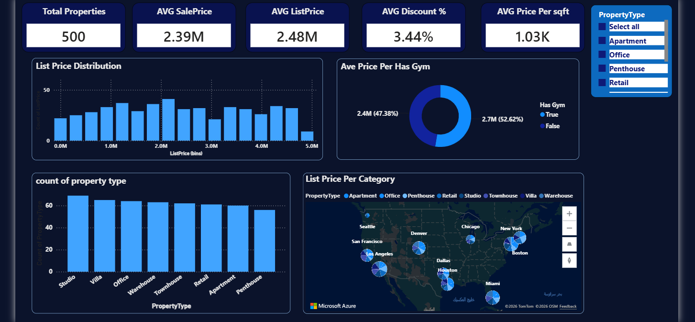
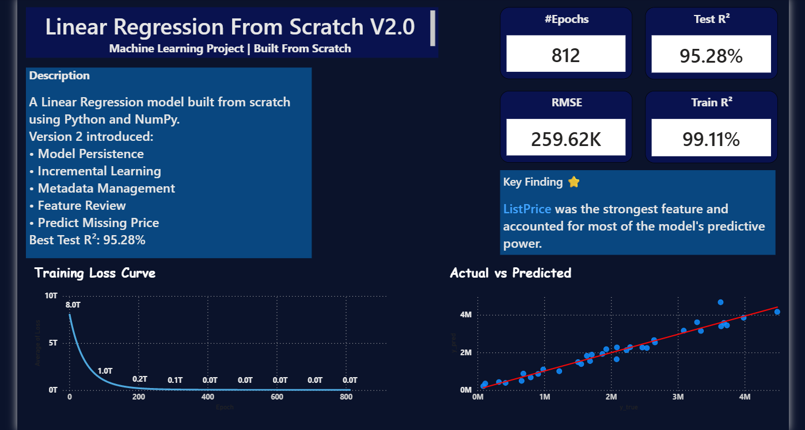
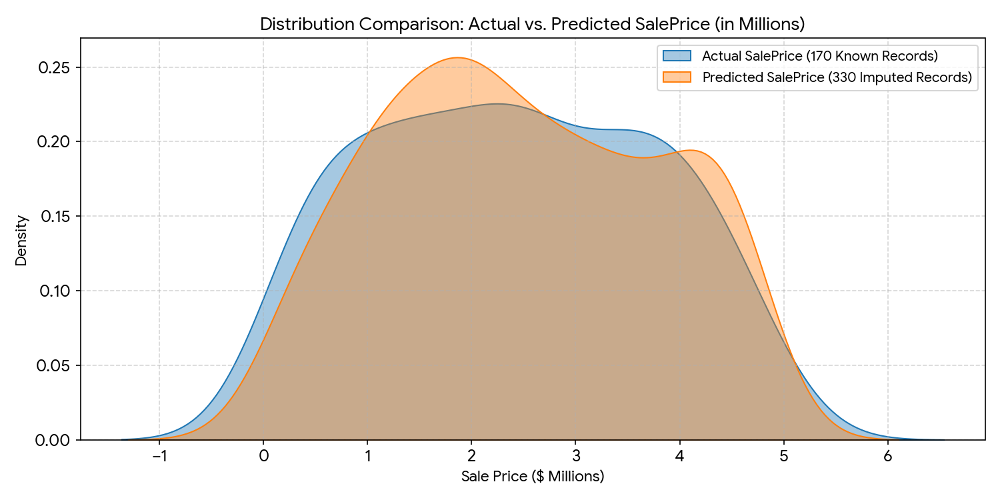

# 🚀 Linear Regression From Scratch v2.0

> **An End-to-End Machine Learning Lifecycle & Real Estate Pricing Engine built from scratch in Python (OOP & NumPy) — without Scikit-Learn.**

---

## 🧭 Project Journey

**Version 1** focused on building a complete Linear Regression model from scratch—implementing the mathematical core, gradient descent, and evaluation metrics.

**Version 2** shifted the focus toward what happens *after* a model is built. Instead of only asking:

> *"Can the model make predictions?"*

Version 2 tackled deeper, production-level engineering questions:

* 💾 Can the model be saved and loaded accurately?
* 🔄 Can training continue later (Incremental Learning)?
* 🔬 Which features actually help, and which ones are redundant?
* 🛡️ Which features leak future information?
* 📉 Are performance limitations caused by the model or the dataset itself?
* 🏠 Can the trained model impute missing prices in a real-world dataset?

As a result, the project evolved from implementing an algorithm to engineering the **complete lifecycle of a machine learning system**.

---

## 🎯 Version 2 Focus

The main goals achieved in Version 2:

* 💾 **Save & Load Model** (Serialization)
* 🔄 **Incremental Learning** (Continued Training)
* 🗂️ **Metadata Management System** (`metadata.json`)
* 🔬 **Feature Review & Auditing**
* 🧪 **Feature Engineering Experiments**
* 🛡️ **Data Leakage Investigation**
* 🏠 **Missing Value Imputation** (Real-World Inference)
* 📈 **Power BI Integration**
* 📝 **Comprehensive Project Documentation**
* 🧠 **Understanding Linear Regression Boundaries**

---

## 💾 Save & Load Model

One of the biggest additions in Version 2 was the ability to save and reload trained models without retraining from scratch.

**Implemented:**
* ✅ Save Weights & Bias (`save_model`)
* ✅ Load Weights & Bias (`@classmethod load_model`)

This transformed the workflow from:

```text
Train Once
```

into a reusable production lifecycle:

```text
Train  ──►  Save  ──►  Load  ──►  Predict
```

Verification tests confirmed that the reloaded model produced **identical predictions** to the original in-memory model, proving that model persistence worked reliably.

---

## 🗂️ Metadata System (`metadata.json`)

Saving model weights alone is not enough—a machine learning model also requires exact preprocessing parameters to make accurate future predictions.

Version 2 introduced a dedicated `metadata.json` file storing:
* 📌 **Feature Names** (in exact training column order)
* 📌 **Mean Values** (per feature)
* 📌 **Standard Deviations** (per feature)

During inference, `new_samples[mean.index]` enforces strict column alignment and ensures future data is scaled identically to the training set—eliminating **Training-Serving Skew**.

---

## 🔄 Incremental Learning

Version 2 introduced **Incremental Learning** support, allowing an existing model to continue learning from new data or additional epochs without resetting learned weights.

**Workflow:**

```text
Load Existing Model  ──►  Continue Training  ──►  Update Weights  ──►  Save Again
```

**Validation Findings:**
* Previous weights were loaded accurately.
* Additional training epochs updated the weights smoothly (`Before` vs `After` inspection).
* Although performance gains were small (since the model had already converged on the available dataset), the experiment confirmed that incremental updates functioned properly.

---

## 🔬 Feature Review

Before creating new features, every existing variable was audited against three strict questions:
1. *Is this feature genuinely useful?*
2. *Does it contain Data Leakage?*
3. *Will it actually exist at prediction time?*

### 1. `DaysOnMarket` — ❌ Removed (Data Leakage)
* **Investigation:** Represents the total number of days required to sell a property.
* **Problem:** This information does not exist when pricing a property that has not been sold yet.
* **Conclusion:** `Potential Data Leakage` → **Removed from training features.**

### 2. `PricePerSqFt` — ✅ Kept (Verified Leak-Free)
* **Investigation:** Verified that the column was calculated using `ListPrice / SqFt` and **not** `SalePrice / SqFt`.
* **Conclusion:** `Not Data Leakage` → Safe to use at prediction time.

### 3. `ListPrice` — 🔍 Key Driver Discovery
* **Discovery:** Removing `ListPrice` caused model performance to collapse dramatically:

| Experiment Setup | R² Score | Observation |
| :--- | :---: | :--- |
| **With `ListPrice`** | **`~95.46%`** | Captures primary market valuation signal |
| **Without `ListPrice`** | **`< 0`** | Remaining features alone cannot explain variance linearly |

* **Takeaway:** Demonstrated how a dominant anchor feature drives linear valuation, while raising an important deployment question: *Will `ListPrice` always be available during real-world inference?*

---

## 🧪 Feature Engineering Experiments (`Feature_Review.md`)

A core objective of Version 2 was empirically testing whether engineered features could push model accuracy further. Every hypothesis was tested and documented:

| Engineered Feature | Formula / Idea | Result | Decision |
| :--- | :--- | :--- | :---: |
| **`Floor` Analysis** | Higher floors increase property value | No linear pattern found in scatter plots | ❌ **Rejected** |
| **`HouseAge`** | `2026 - YearBuilt` for better interpretability | Identical performance (`R² = -0.523` without `ListPrice`); redundant with `YearBuilt` | ❌ **Rejected** |
| **`AreaPerBedroom`** | `SqFt / Bedrooms` | Distorted by `0`-bedroom commercial units (offices/retail) and non-bedroom spaces | ❌ **Rejected** |
| **`NeighborhoodScore`** | Average `SalePrice` per neighborhood | `R²` dropped (`0.9528` → `0.9511`) & `RMSE` increased (`259,622` → `264,182`); redundant with One-Hot Encoding | ❌ **Rejected** |

---

## 🛡️ Data Leakage Lessons

Version 2 reshaped how features are evaluated before modeling. The single most valuable rule learned during this phase:

> **"Would this exact piece of information exist in the real world at the moment we need a prediction?"**

Applying this single question prevented data leakage early and kept the pipeline realistic.

---

## 📈 Power BI Integration

Power BI dashboards were integrated alongside Python visualizations to:
* 📊 Explore feature relationships and distributions.
* 📉 Monitor training loss convergence across epochs.
* 🔍 Compare actual vs. predicted property prices visually to support feature review decisions.

---

## 🧩 Challenges Faced During Version 2

* **Separating Intuition from Evidence:** Many feature engineering ideas made complete sense from a human perspective, yet experiments proved that `Human Intuition ≠ Model Improvement`.
* **Diagnosing Performance Ceilings:** When multiple engineered features failed to improve `R²`, it raised a critical question: *Is the bottleneck coming from Linear Regression or from the dataset itself?* Answering this requires benchmarking non-linear models in Version 3.
* **Validating Incremental Learning:** Implementing continued training was straightforward, but proving it worked required tracking weight updates before and after additional training runs.

---

## 💡 Key Lessons Learned

* 🧠 Understanding data and domain logic is more important than model complexity.
* 📉 Not every feature that makes sense to humans helps the algorithm.
* ➕ Good feature engineering adds *new* information rather than rephrasing existing columns.
* 🛡️ Data leakage must always be audited before training.
* 📓 Negative results (`Feature_Review.md`) provide valuable insights and prevent repeated mistakes.
* 🚀 Shipping a clean, working release (`v2.0`) is more valuable than endlessly polishing unfinished features.

---

## 🏆 Results

Current test set performance on labeled property records:

| Metric | Value |
| :--- | :--- |
| **R² Score (Test)** | **`~95.27%`** |
| **RMSE** | **`~254,506`** |
| **MSE** | **`~64.77 Billion`** |

Beyond metrics, Version 2 delivered major architectural upgrades in project modularity, model persistence, metadata management, and data leakage auditing.

---

## 📊 Power BI Dashboard Preview

An interactive dark-themed Power BI report was built to monitor model convergence, evaluation metrics, and real estate market distributions:

### 2. Real Estate Market Exploration (`Dataset Overview`)



### 1. Model Performance & Key Findings (`Model Dashboard`)



> *Note: A third deep-dive page (`Analysis Dashboard`) is currently in progress and scheduled for release in **v2.1**.*

---

## 🏠 Missing Value Imputation (Real-World Inference)

After validating the model and saving both weights and metadata, the final step of Version 2 was applying the trained model to a real business task.

The original dataset contained **500 property records** (19 raw features expanded to 78 encoded features):
* **170 records (34%)** with known `SalePrice` (used for training and testing)
* **330 records (66%)** with missing `SalePrice` (~`$816.73M` in unpriced inventory)

Using the `predict_new_samples` pipeline in `train.py`, the saved model estimated the missing prices and exported them in an independent column (`Predicted_SalePrice` → `data/predicted_SalePrice.csv`).

### ⚙️ Inference Workflow

```text
Load metadata.json  ──►  Align & Scale Features (mean.index)  ──►  Load Saved Model  ──►  Predict Missing SalePrice  ──►  Save CSV
```

### 📊 Validation & Distribution Check

Since the **330 missing records** had no ground-truth `SalePrice` to compute an `R²` score against, the imputed predictions were validated by comparing their statistical distribution against the **170 known properties**:

| Dataset Subset | Record Count | Mean Price | Median Price |
| :--- | :---: | :---: | :---: |
| **Known `SalePrice` (Ground Truth)** | 170 | `$2,392,897` | **`$2,395,132`** |
| **Predicted `SalePrice` (Imputed)** | 330 | `$2,474,932` | **`$2,386,313`** |

> **Key Takeaway:** The median predicted price (**`$2,386,313`**) aligns closely with the actual market median (**`$2,395,132`**), confirming that the model preserved the true market distribution without any major shift.



### ⚠️ Model Boundary Observation

Out of the **330 imputed properties**, **328 predictions** fell squarely within realistic market ranges. However, **2 extreme low-priced properties** (`ListPrice < $315,000`) resulted in slightly negative predicted prices (`-$32,044` and `-$64,773`).

This happens because standard Linear Regression is mathematically unbounded:

```text
-∞ < ŷ < +∞
```

> **Engineering Insight:** Documenting this edge-case behavior directly motivates testing bounded, non-linear tree-based algorithms in Version 3.0.

---

## 🎯 Version 2 Conclusion

Version 2 was less about chasing a slightly higher metric and more about becoming a better machine learning engineer. Several feature engineering hypotheses were tested, assumptions were challenged, and every finding was documented.

The biggest outcome of Version 2 was learning how to question assumptions, audit features for data leakage, build reproducible inference pipelines, and understand the mathematical limits of linear models.

---

## 🗺️ What Comes Next? (Version 3.0 Roadmap)

The dataset will remain unchanged so multiple algorithms can be benchmarked fairly on the exact same data:

```text
Decision Tree Regression
        │
        ▼
Random Forest Regression
        │
        ▼
K-Nearest Neighbors (KNN) Regression
        │
        ▼
Logistic Regression & Unsupervised Learning Extensions
```

Only after comparing these models against Linear Regression will final conclusions be drawn regarding whether the remaining `~4.5%` variance comes from model linearity or the dataset itself.

---

## 👤 Author

**Mahmoud Azzam**
*Computer Science & AI Student | Data Analysis & Machine Learning Engineering*
Focused on building ML algorithms from scratch, understanding the mathematics and engineering logic behind every component, and documenting real-world lessons learned.

### الحمد لله