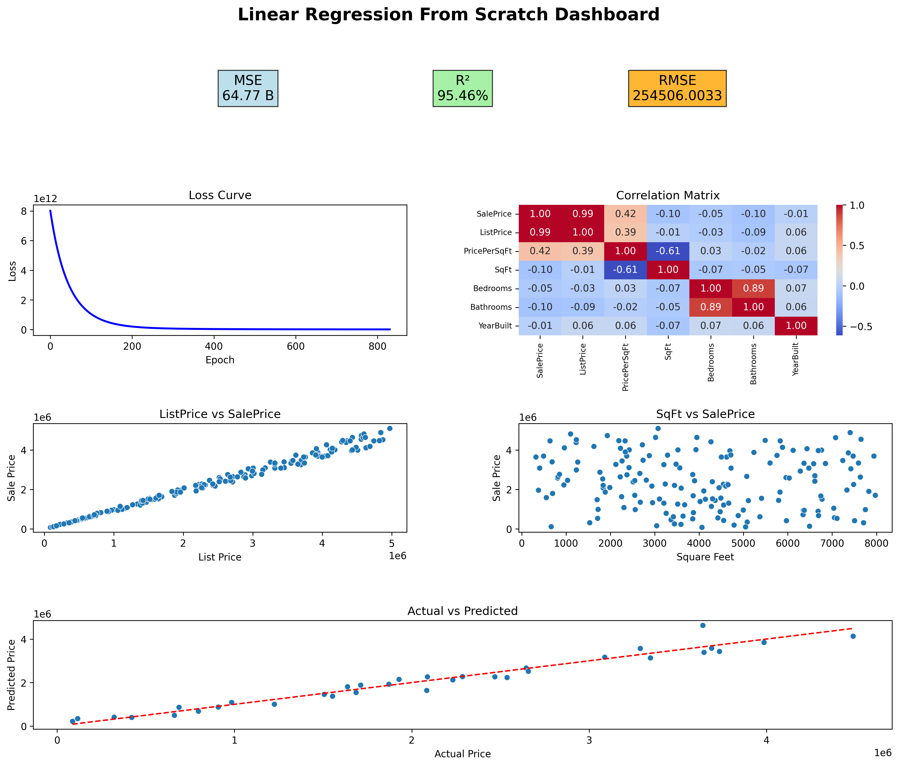

# Project Journey

This project started as a simple attempt to build Linear Regression from scratch.

However, throughout the process, it evolved into a complete machine learning learning experience.

## Week 1

### Understanding the Dataset

- Explored the housing dataset.
- Investigated feature relationships.
- Learned how correlation can be used as a tool for understanding data.
- Discovered potential data leakage features.

###  Data Preparation

- Removed non-informative columns.
- Removed possible leakage features.
- Applied One-Hot Encoding.
- Built a preprocessing pipeline.

### Feature Scaling

- Implemented Standardization manually.
- Learned why scaling should be performed using training statistics only.
- Avoided data leakage by using training mean and standard deviation.

### Building Linear Regression

Implemented:

- Prediction Function
- Cost Function (MSE)
- Gradient Descent
- Training Loop

The goal was understanding the algorithm rather than simply using a library.

---

## Week 2

### Model Evaluation

Implemented:

- MSE
- RMSE
- R² Score

Learned that good metrics alone are not enough and must be interpreted carefully.

### Feature Importance Experiment

One of the most important discoveries was the impact of:

ListPrice

Results:

- With ListPrice → R² ≈ 95%
- Without ListPrice → R² < 0

This experiment demonstrated how a single feature can dominate model performance.

### Early Stopping

Implemented Early Stopping using relative improvement between consecutive losses.

Learned that relative tolerance is more flexible than absolute tolerance.

### Visual Analysis

Built a complete visualization dashboard including:

- Loss Curve
- Correlation Matrix
- ListPrice vs SalePrice
- SqFt vs SalePrice
- Actual vs Predicted

These visualizations made model behavior easier to understand than relying on metrics alone.

### Dashboard Design

Learned that visualizations should answer questions rather than simply look good.

---

## Dashboard Preview

---
## Challenges Faced During The Project

Throughout the project, several challenges appeared that required experimentation, debugging, and rethinking assumptions.

### Understanding Data Leakage

At the beginning, distinguishing between useful features and leakage features was not always obvious.

The main challenge was learning how to ask:

> Would this information actually exist when making a real prediction?

This question led to removing features that could leak information from the future.

---

### Standardization Edge Case

While implementing feature scaling, some columns had:

Std = 0

because all values were identical.

This caused division-by-zero issues and produced invalid values during scaling.

The solution was handling constant features before applying standardization.
---
### Feature Importance Experiment

One of the most important discoveries was the impact of:

ListPrice

Results:

- With ListPrice → R² ≈ 95%
- Without ListPrice → R² < 0

This experiment demonstrated how a single feature can dominate model performance.

Further investigation showed:

- Train R² = 0.54
- Test R² = -0.43

after removing ListPrice.

This experiment proved that most of the model's predictive power came from ListPrice.

Without it, the remaining features were not sufficient to explain SalePrice effectively, causing model performance to collapse.

---

### Early Stopping

Designing Early Stopping was more difficult than expected.

Using a fixed improvement threshold produced inconsistent behavior because loss values can vary greatly between datasets.

The solution was to use relative improvement instead of absolute improvement.

---

### Visualization Challenges

Creating visualizations was not only about drawing charts.

The challenge was deciding:

- Which visualizations were actually useful.
- Which visualizations explained model behavior.
- Which visualizations added no value.

Several iterations were required before reaching a dashboard that clearly told the project's story.

---

### Dashboard Layout

Building the visualization dashboard required multiple iterations.

The challenge was balancing readability, spacing, and information density while keeping all visualizations inside a single dashboard view.

Several layout adjustments were required before reaching the final design.

---

### Correlation Matrix After One-Hot Encoding

After applying One-Hot Encoding, the correlation matrix became crowded and difficult to interpret.

The solution was generating a clean correlation matrix using only important numerical features before encoding.

---

### Scope Creep

One of the biggest personal challenges during the project.

Many ideas appeared before completing the first version:

- New datasets
- Power BI dashboards
- Feature Engineering
- Additional model features

The challenge was learning when to stop adding features and focus on finishing the current version.
---

### Implementing Metrics From Scratch

Instead of using library functions, all evaluation metrics were implemented manually.

This required understanding the mathematics behind:

- MSE
- RMSE
- R² Score

and validating that the implementation produced reasonable results.

---

### Project Organization

As the project grew, keeping the code organized became increasingly important.

The solution was separating responsibilities into folders such as:

- preprocessing
- models
- metrics
- visualization

This made the project easier to maintain and understand.

---

## Key Lessons From This Project

- Understanding data is often more important than building a model.
- High R² does not automatically mean a good model.
- Negative results can reveal important insights.
- Correlation is a tool for understanding, not a rule for deletion.
- Feature engineering and feature selection often have more impact than changing the model itself.
- Finished projects are better than endlessly improving unfinished ones.
---
# Results

MSE  : 64.77 Billion

RMSE : 254,506

R²   : 95.46%

---

## Sample Predictions

The model produced accurate predictions for many properties while still making noticeable errors in some cases.

### Example 1: Accurate Prediction

True Price: 2,285,509

Predicted Price: 2,280,414

Difference: 5,095

### Example 2: Large Prediction Error

True Price: 115,844

Predicted Price: 353,224

Difference: 237,380

This demonstrates that overall metrics can be strong while individual predictions may still contain significant errors.

---

## What Comes Next?

Version 2 will focus on:

- Incremental Learning
- Save / Load Model
- Feature Engineering
- Larger Real-Estate Dataset
- Power BI Interactive Dashboard
- Additional Dataset Evaluation

# Author

Mahmoud Azzam

Computer Science Student

Interested in Data Analysis and Machine Learning.

I prefer learning through building projects from scratch, understanding the logic behind every step, and documenting lessons learned throughout the journey.

# وتم بحمد الله 